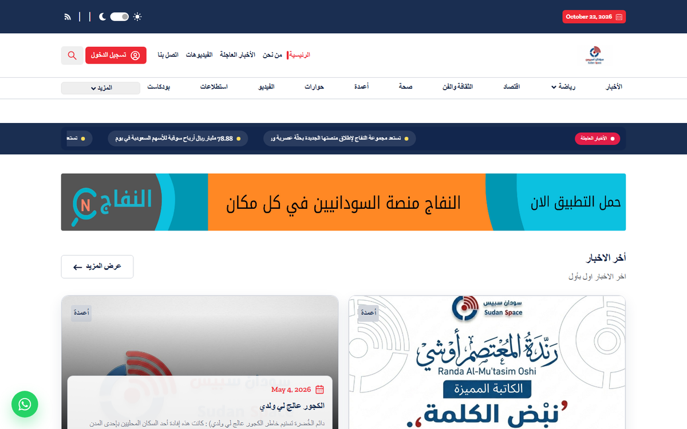

# Sudan Space — Digital Platform

Sudan Space is a digital platform and mobile app suite for news and content, built with multilingual support and secure authentication.

## Highlights

- Web and mobile application suite
- Complex state management
- Multilingual support
- Secure enterprise authentication
- Production releases for the platform

## Tech stack

Flutter · Dart · Riverpod · GraphQL · OAuth2

## My role

**Flutter Developer at Al Oula Saudi** — platform development and production releases.

## Links

- Live product: [sudanspace.com](https://sudanspace.com)
